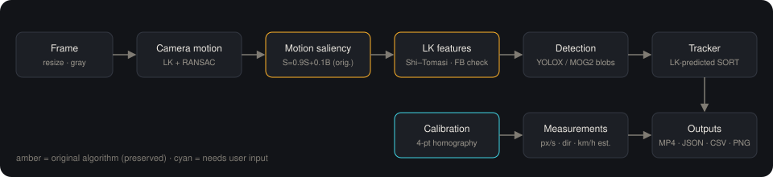

# MotionScope

Lucas–Kanade optical flow, motion saliency and vehicle tracking for traffic video, with a web interface and calibrated speed estimation.

https://github.com/user-attachments/assets/dc9c5cb7-482c-4070-a8f8-2d9f5a5642cd

## Features

- Pyramidal Lucas–Kanade optical flow on Shi–Tomasi corners with forward–backward validation
- Accumulated motion-saliency map with camera-shake compensation
- Vehicle detection (YOLOX or motion blobs) with persistent IDs from a SORT-style tracker
- Speed estimation through a four-point ground-plane homography
- Annotated video output, JSON report, CSV tracks, motion heat map and trajectory map
- Web interface with upload, calibration, live progress, original / processed comparison and a results dashboard

## Tech stack

Python · OpenCV · NumPy · FastAPI · HTML / CSS / JavaScript

## Installation

```bash
git clone https://github.com/MOHIT-vp/motionscope.git
cd motionscope
python3 -m venv .venv
.venv/bin/pip install -r requirements.txt
.venv/bin/python scripts/fetch_model.py
```

## Usage

Web app:

```bash
.venv/bin/uvicorn backend.main:app --port 8000
```

Command line:

```bash
.venv/bin/python -m motiontrack.cli input.mp4 -o output --calibration samples/ex-1.calibration.json
```

Docker:

```bash
docker build -t motionscope .
docker run -p 7860:7860 motionscope
```

## Method



1. Frame preprocessing (resize, grayscale)
2. Camera-motion estimation and compensation
3. Motion saliency: `S = 0.9·S + 0.1·B`
4. Lucas–Kanade feature tracking
5. Moving-vehicle detection
6. Multi-object tracking and measurement
7. Rendering and reporting

## Project structure

```
motiontrack/    computer-vision package
backend/        FastAPI server
frontend/       web interface
demos/          demonstration outputs
samples/        calibration files
scripts/        utility scripts
tests/          test suite
docs/           technical documentation
legacy/         original implementation and report
```

## Testing

```bash
.venv/bin/pip install -r requirements-dev.txt
.venv/bin/python -m pytest -q
```

## Documentation

- [Technical report](docs/TECHNICAL_REPORT.md)
- [Historical notes](docs/HISTORICAL_NOTES.md)
- [Design brief](docs/design/BRIEF.md)

## References

- B. D. Lucas and T. Kanade, *An iterative image registration technique with an application to stereo vision*, IJCAI 1981.
- J. Shi and C. Tomasi, *Good features to track*, CVPR 1994.
- A. Bewley et al., *Simple online and realtime tracking*, ICIP 2016.
- Z. Ge et al., *YOLOX: Exceeding YOLO series in 2021*, 2021.
